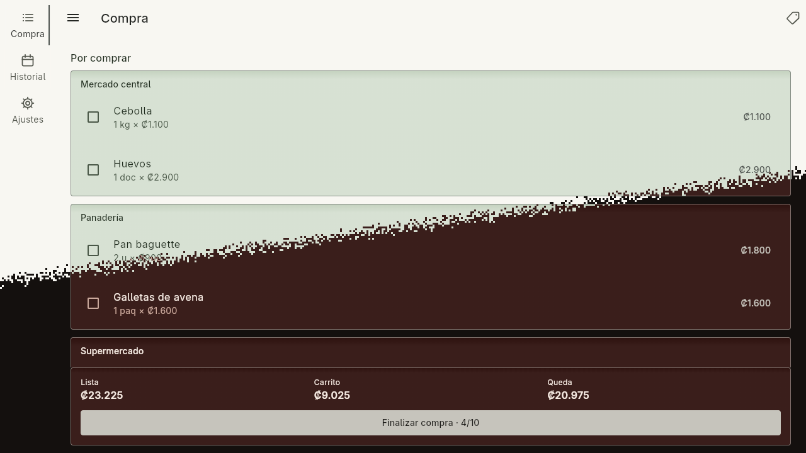
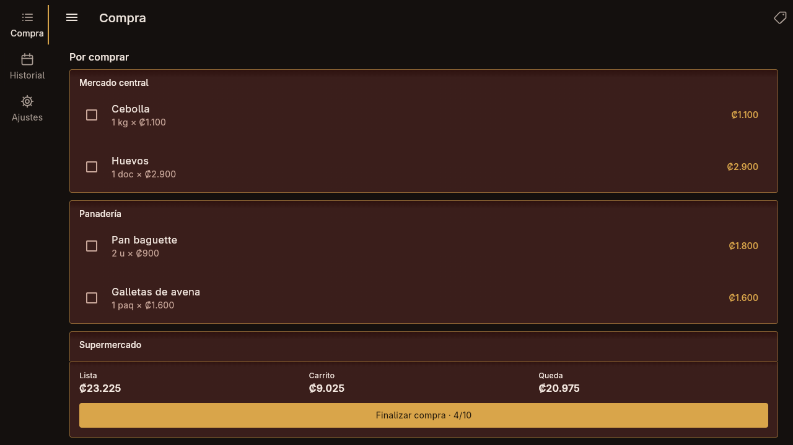
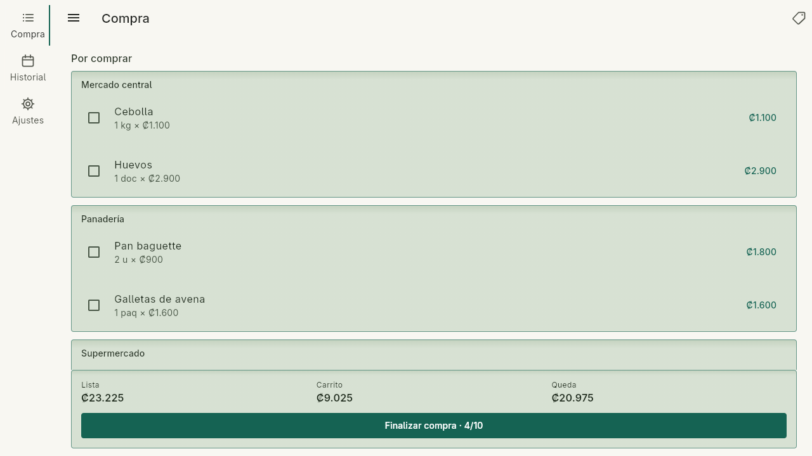

<div align="center">

# BuyingVulpes

**Listas de compras por tienda, con presupuesto a la vista y un desglose de cada compra.**


</div>

---

## Qué es

BuyingVulpes organiza la compra de la casa tienda por tienda. Cada producto guarda su precio por
medida; la lista se recorre con casillas que pasan cada artículo al carrito, y el total se
compara con el presupuesto mientras se compra. Al terminar, la compra queda archivada en un
calendario con su desglose en PDF.

<p align="center">
  
</p>
<p align="center">
  
  
</p>

<p align="center"><sub>Datos de demostración. Las capturas se regeneran con <code>tools/capturas/capturas.sh</code>.</sub></p>

## Funciones principales

- Catálogo de productos por tienda, con precio por unidad, peso o volumen.
- Lista de compras con casillas: lo marcado pasa al carrito.
- Presupuesto visible en todo momento.
- Desglose en PDF de cada compra, archivado por fecha.
- Funciona sin conexión: los datos viven en el dispositivo.

## Tecnologías

| Capa | Tecnología |
|---|---|
| Interfaz | Flutter · [Wulfenite UI](#requisitos) (sistema de diseño propio) |
| Estado | Riverpod |
| Datos | SQLite (`sqflite`, `sqflite_common_ffi` en escritorio) |
| Documentos | `pdf` |

## Requisitos

- Flutter 3.x (Dart ≥ 3.9).
- La librería **Wulfenite UI**, de NoctiVulp, clonada en `../#Libs/wulfenite_ui` (ruta indicada
  en `pubspec.yaml`).

## Puesta en marcha

```bash
flutter pub get
flutter run -d linux        # o un dispositivo Android
flutter test
```

## Documentación

La arquitectura y las decisiones de diseño están en [`docs/`](docs/index.md).

## Licencia

Código bajo **GPL-3.0-or-later** ([`LICENSE`](LICENSE)). Los componentes de terceros y sus licencias
están en [`NOTICE`](NOTICE). El nombre y la identidad visual no forman parte de la licencia: ver
[`TRADEMARKS.md`](TRADEMARKS.md). Para aportar, [`CONTRIBUTING.md`](CONTRIBUTING.md).

## Apoyo

Este proyecto forma parte del trabajo de **NoctiVulp**: herramientas para Linux y Android,
publicadas como software libre. Las compilaciones oficiales y las novedades salen en Patreon.

<p align="center">
  <a href="https://www.patreon.com/cw/NoctiVulp"></a>
</p>

---

<p align="center"><sub>© 2026 NoctiVulp · <b>Powered by AI</b> — desarrollado con la asistencia de Claude, de Anthropic.</sub></p>
